<div align="center">

# amw-lite

**Lightweight, Open-Source Multi-Repo AI Agent Workspace**

For 2–5 person microservice teams collaborating across Claude Code, Codex, and Cursor.

[](https://github.com/chengjian0813/amw-lite/actions/workflows/ci.yml)
[](https://www.python.org/downloads/)
[](LICENSE)

**English** | [简体中文](README.zh-CN.md)

</div>

---

`amw-lite` gives small backend teams a clean Git control repository, isolated multi-repo Git Worktrees, minimal native Markdown Specs, commit-bound verification, and pluggable external CLI hooks (with Alibaba's open-source [`ocr`](https://github.com/alibaba/open-code-review) Code Review CLI wired out of the box) — all in **under 4,000 lines of Python** with **only one runtime dependency (`PyYAML`, MIT)**.

## Why `amw-lite`?

When a small team modifies multiple microservices together with different Coding Agents (Claude Code, Codex, Cursor), both extremes fail:

| Approach | What breaks in practice |
|---|---|
| **Ad-hoc / No Workspace** | Agents pollute daily checkouts, guess cross-repo APIs, skip tests after last-minute fixes, and follow inconsistent rules across tools. |
| **Heavy Platform / Meta-Framework** | Tens of thousands of lines of orchestration, local SQLite indexes, rigid approval bureaucracy, heavy third-party workflow engines, and AGPL risks create high onboarding friction and over-constrain modern LLMs. |
| **`amw-lite`** | **Minimal native Markdown Specs + isolated multi-repo Git Worktrees + 6 human decision gates + 4 hard-coded safety guardrails.** Let humans make decisions and let strong models + open CLIs do the heavy lifting. |

### The 6 Human Decision Gates & 4 Hard Safety Guardrails

```mermaid
flowchart LR
    G1["Gate 1: Brief (brief.md)"] --> G2["Gate 2: Design & Contracts (design.md)"]
    G2 --> DEV["Agent: Worktrees -> Code -> Parallel Check"]
    DEV --> G3["Gate 3: Code Review (ocr + Human / Fix in Branch)"]
    G3 --> G4["Gate 4: E2E Cases (e2e-plan.md)"]
    G4 --> E2E["Run E2E (Fix Bugs in Branch -> Re-Check/Review)"]
    E2E --> G5["Gate 5: E2E Results"]
    G5 --> MR["Human Merges MR -> task finish"]
    MR --> G6["Gate 6: Release Plan + Distill 1-3 Learnings"]
```



**4 safety guardrails enforced in code (never left to prompts alone):**
1. **Read-only source checkouts**: Business code edits happen exclusively in `.worktrees/<REQ>/<TASK>/<REPO>/`; never runs `git reset --hard` or deletes dirty worktrees.
2. **Commit-bound evidence**: Unit-test checks and Code Reviews bind to exact `HEAD SHA + clean worktree`; any new fix commit automatically invalidates stale evidence for the modified repo while reusing passing checks for untouched repos.
3. **Static secret & path guard**: Blocks obvious tokens, private keys, credentialed URIs, machine-local absolute paths, and unresolved placeholders from entering tracked files.
4. **Human boundary on shared side effects**: Never auto-pushes, never auto-merges MRs, and **hard-blocks `--env prod` auto-deployment**.

---

## Workspace Layout at a Glance

Control repository tracks specs/configs cleanly per `req/task` folder (zero nested control-repo worktrees); only business repositories use Git Worktrees:

```text
order-workspace/                          # Control Git repo (shared by the team)
├── AGENTS.md / CLAUDE.md                 # Thin entrypoints for Codex, Claude Code, Cursor
├── .workspace/
│   ├── workspace.yaml                    # Workspace identity & external CLI hooks (committed)
│   ├── repositories.yaml                 # Logical multi-repo registry (committed)
│   ├── local.yaml                        # Machine-local repo paths (gitignored)
│   └── skills-src/amw-lite/SKILL.md      # Single source synced to .agents/.claude/.cursor
├── context/                              # Long-term domain & repo knowledge
├── contracts/                            # Cross-repo contracts (status: draft | accepted)
├── requirements/REQ-001/
│   ├── requirement.yaml                  # Requirement metadata & 5 gate flags
│   ├── brief.md                          # Gate #1: requirement understanding
│   ├── design.md                         # Gate #2: system design
│   ├── e2e-plan.md                       # Gates #4 & #5: E2E cases & observed results
│   ├── release-plan.md                   # Gate #6: verified commits, order & rollback
│   └── tasks/
│       ├── T01/{task.yaml, plan.md}      # Isolated per-task folder (parallel-friendly)
│       └── T02/{task.yaml, plan.md}
└── .worktrees/REQ-001/T01/               # Gitignored; business repo worktrees only
    ├── order-core/                       # Branch: amw/REQ-001/T01
    └── order-biz/                        # Branch: amw/REQ-001/T01
```

---

## 10-Minute Quick Start

**Prerequisites:** Python `3.10+` and Git.

### 1. Install `amw-lite`

```bash
# Install globally with uv (recommended)
uv tool install git+https://github.com/chengjian0813/amw-lite.git

# Or with pipx / pip
pipx install git+https://github.com/chengjian0813/amw-lite.git

amw-lite --version
```

### 2. Initialize a Workspace

```bash
mkdir order-workspace && cd order-workspace
git init -b main

amw-lite init \
  --id order-domain \
  --name "Order Domain Workspace" \
  --repo order-core=/abs/path/to/order-core \
  --repo order-biz=/abs/path/to/order-biz

amw-lite doctor
```

> New teammates only need to clone `order-workspace`, copy `.workspace/local.example.yaml` to `.workspace/local.yaml`, fill in their own local checkout paths, and run `amw-lite doctor`.

### 3. Drive via Natural Language (Recommended)

`amw-lite init` installs a single-source Companion Skill across **Codex** (`.agents/skills/amw-lite`), **Claude Code** (`.claude/skills/amw-lite`), and **Cursor** (`.cursor/skills/amw-lite`).

Open your Coding Agent in `order-workspace` and say:

> Use the `amw-lite` skill: run `amw-lite resume --json` and guide me through the next step.

Your Agent inspects live facts via `--json`, checks `--help` for exact flags, automates the mechanical middle, and pauses cleanly at the 6 human decision gates.

### 4. Or Run the CLI Directly

```bash
# Step 1: Requirement Brief (Gate #1) & System Design + Contracts (Gate #2)
amw-lite req new REQ-001 --title "Multi-currency checkout"
# Fill brief.md, design.md, and set contracts/*.md frontmatter `status: accepted`
amw-lite req approve REQ-001 --gate brief
amw-lite req approve REQ-001 --gate design

# Step 2: Create Tasks & Start Isolated Multi-Repo Worktrees
amw-lite task new REQ-001 T01 --repos order-core,order-biz --title "Core + Biz checkout"
# Fill requirements/REQ-001/tasks/T01/plan.md
amw-lite task start REQ-001 T01

# Step 3: Code in .worktrees/REQ-001/T01/<repo>, Commit, Check & Code Review (Gate #3)
amw-lite task check REQ-001 T01
amw-lite task review REQ-001 T01          # Invokes Alibaba `ocr` CLI (or diff-stat fallback)
# Need changes? Fix directly in the current Task branch, commit, re-run check & review!
amw-lite task review REQ-001 T01 --approve

# Step 4: E2E Testing in Current Branch (Gates #4 & #5)
amw-lite req approve REQ-001 --gate e2e-plan
amw-lite e2e run REQ-001 --apply          # Optional external E2E hook (or run manually)
# Found a bug? Fix directly in the current Task branch, commit, re-run check/review/e2e!
amw-lite req approve REQ-001 --gate e2e-result

# Step 5: MR Handoff, Merge, Release Plan (Gate #6), Knowledge & Cleanup
amw-lite task mr REQ-001 T01              # Prints exact push command & PR/MR URL
# Human pushes & merges business MR(s) into baseline
amw-lite task finish REQ-001 T01
amw-lite release plan REQ-001
amw-lite req approve REQ-001 --gate release-plan
# Optional: review 1-3 distilled learnings proposed by Agent and append chosen items to context/
amw-lite req close REQ-001
amw-lite task cleanup REQ-001 T01 --apply
```

---

## In-Branch Fixes & Flexible E2E Ordering

- **Never create extra fix branches before merge**: If Code Review (`ocr` or human) or E2E reveals an issue, fix it **directly in the current Task branch and worktree**, commit, and re-run `check` + `review`. Untouched repositories automatically `REUSE` their passing check evidence; only modified repositories re-run.
- **Both E2E workflows work out of the box**:
  - *Default (clean mainline)*: Finish CR + E2E on the Task branch first, then merge MR.
  - *Multi-task integration E2E*: Merge multiple Tasks to baseline first, then run requirement-level E2E. `amw-lite` enforces the final gate only before `release plan`, `release run`, and `req close`.

---

## Pluggable External CLI Hooks

All hooks run strictly via `argv` arrays (`shell=False`) with variable allow-listing and timeout guards.

### Built-In Code Review Preset: Alibaba Open Code Review (`ocr`)

`amw-lite` integrates Alibaba's open-source [`ocr`](https://github.com/alibaba/open-code-review) CLI (Apache-2.0) out of the box instead of building a proprietary review engine:

```bash
npm install -g @alibaba-group/open-code-review
```

`amw-lite task review` automatically invokes `ocr` per repository worktree with the frozen baseline commit, current `HEAD`, and a concise requirement/design summary:

```bash
ocr review --from <baseline_commit> --to <head_commit> --background "<brief+design summary>" --audience agent --format json
```

- You can also switch to `--background-file {design_path}` in `.workspace/workspace.yaml`.
- If `ocr` is not installed, `amw-lite` gracefully falls back to `git diff --stat` so manual review + `--approve` still works seamlessly.

### Optional E2E & Fast Release Hooks

Configure team-specific tools in `.workspace/workspace.yaml` (or machine overrides in `.workspace/local.yaml`):

```yaml
hooks:
  e2e:
    enabled: true
    argv: ["my-e2e-cli", "run", "--plan", "{e2e_plan_path}"]
  release:
    enabled: true
    policy:
      qa: ask
      pre: ask
      prod: manual   # PROD auto-deploy is hard-blocked (exit code 3)
    argv: ["my-deploy-cli", "deploy", "--plan", "{release_plan_path}", "--env", "{env}"]
```

### Lightweight Knowledge Distillation

Instead of a heavy multi-tier approval workflow that teams forget to trigger, knowledge capture happens at one natural moment — **right after Release Plan approval and before `req close`**. Your Agent distills **1–3 durable learnings** from `design.md` vs actual diffs/fixes; you simply reply which numbers to keep (or skip all), and selected items append directly to `context/`.

---

## Command Reference

Every command accepts `--json` (before or after the subcommand) and `--workspace <dir>`.

| Command | Purpose |
|---|---|
| `amw-lite init` | Scaffold a new Workspace control repo and sync Companion Skill |
| `amw-lite doctor` | Read-only diagnostics for Git, repo remotes, skills, hooks, DAG cycles, and secrets |
| `amw-lite resume [--refresh]` | Show current status, EffectiveStage, blockers, and single `NEXT` action |
| `amw-lite skills sync [--apply] \| check` | Single-source sync & drift protection across Codex / Claude / Cursor |
| `amw-lite req new \| approve \| close` | Manage Requirement specs and human decision gates |
| `amw-lite task new \| start \| check \| review \| mr \| finish \| cleanup` | Multi-repo Task, Worktree, Commit-bound Check, OCR Review, MR & Cleanup |
| `amw-lite e2e run <REQ> [--apply]` | Preview or invoke configured E2E hook |
| `amw-lite release plan \| run` | Generate verified `release-plan.md` or invoke QA/PRE release hook |

**Exit Codes:** `0` OK · `1` Command/hook execution failure · `2` Config/schema/security validation failure · `3` Safety block (dirty worktree, unmerged branch, PROD auto-deploy) · `4` External dependency missing/timeout.

---

## Development & Contributing

```bash
git clone https://github.com/chengjian0813/amw-lite.git
cd amw-lite
uv sync --extra dev
uv run pytest -v
```

## License

MIT License — see [LICENSE](LICENSE).
