<div align="center">

# amw-lite

**轻量、易上手、可开源的多仓 AI Agent Workspace**

面向 2–5 人后端/微服务小团队，统一 Claude Code、Codex、Cursor 的多仓协同研发工作流。

[](https://github.com/chengjian0813/amw-lite/actions/workflows/ci.yml)
[](https://www.python.org/downloads/)
[](LICENSE)

[English](README.md) | **简体中文**

</div>

---

`amw-lite` 为多仓微服务小团队提供一个干净的 Git 控制仓、物理隔离的多仓 Git Worktree、极简原生 Markdown Spec、Commit 绑定验证证据以及开放式外部 CLI 钩子（开箱集成阿里开源 [`ocr`](https://github.com/alibaba/open-code-review) Code Review CLI）——核心代码**不到 4,000 行 Python**，**运行时仅依赖 `PyYAML`（MIT 协议）**，零 AGPL 风险。

## 为什么需要 `amw-lite`？

当 2–5 人研发团队使用不同 Coding Agent（Claude Code、Codex、Cursor）协作修改多个微服务代码仓时，两个极端都容易翻车：

| 方案 | 实战中的真实痛点 |
|---|---|
| **无治理 / 纯自由发挥** | Agent 直接污染日常 checkout、跨仓接口靠口头猜字段、改完最后两行代码不重跑单测、不同工具各玩各的规范。 |
| **过重的平台 / 流程框架** | 数万行编排代码、本地 SQLite 投影索引、繁琐的每步审批与强制填表豁免、重型第三方工作流依赖（甚至含 AGPL 协议），不仅新人上手门槛极高，还会过度约束新一代强模型。 |
| **`amw-lite`** | **极简原生 Markdown Spec + 业务仓 Git Worktree 隔离 + 6 个核心人工拍板点 + 4 条硬编码安全底线。** 把决策权留给人，把编码和机械编排交给强模型与开放外部 CLI。 |

### 人的 6 个核心拍板点 & 4 条物理安全底线

```mermaid
flowchart LR
    G1["拍板 1: 需求理解 (brief.md)"] --> G2["拍板 2: 系分与契约 (design.md)"]
    G2 --> DEV["Agent: 建 Worktree -> 编码 -> 并行单测 Check"]
    DEV --> G3["拍板 3: Code Review (ocr + 人审 / 当前分支直接修)"]
    G3 --> G4["拍板 4: E2E 用例设计 (e2e-plan.md)"]
    G4 --> E2E["执行 E2E (当前分支直接修 Bug -> 重跑 Check/Review)"]
    E2E --> G5["拍板 5: E2E 执行结果"]
    G5 --> MR["人合并 MR -> task finish"]
    MR --> G6["拍板 6: 发布方案 + 提炼 1-3 条领域知识"]
```



**4 条由 CLI 硬代码守护的安全底线（绝不依赖提示词软约束）：**
1. **源仓只读、写进 Worktree**：业务代码改动只在 `.worktrees/<REQ>/<TASK>/<REPO>/` 进行；永不执行 `git reset --hard`，绝不强删脏工作区。
2. **Commit-bound 可信证据**：单测 Check 与 Code Review 强绑定精确 `HEAD SHA + clean 状态`；修复代码产生新提交后，仅修改仓的旧证据自动失效，未改动的仓直接 `REUSE` 跳过重复测试。
3. **静态密钥与路径拦阻**：自动扫描并阻断明文 Token/密钥、私钥头、带凭据 URL、本机绝对路径及未解析占位符进入 Git。
4. **共享副作用必须人工把关**：绝不自动 `git push`、绝不自动合并 MR，且**硬编码禁止 `--env prod` 自动部署**。

---

## 控制仓目录一览

控制仓按 `requirements/<REQ-ID>/tasks/<TASK-ID>/` 独立目录隔离不同任务（告别嵌套控制仓 Worktree 复杂度），仅业务仓使用 Git Worktree 物理隔离：

```text
order-workspace/                          # 独立 Git 控制仓（团队共享）
├── AGENTS.md / CLAUDE.md                 # 薄引导，统一 Codex / Claude Code / Cursor 入口
├── .workspace/
│   ├── workspace.yaml                    # 工作空间身份与外部 CLI 钩子模板（入 Git）
│   ├── repositories.yaml                 # 多仓逻辑清单（入 Git）
│   ├── local.yaml                        # 本机业务仓绝对路径（Git 忽略）
│   └── skills-src/amw-lite/SKILL.md      # 单源 Companion Skill，同步到 .agents/.claude/.cursor
├── context/                              # 长期领域知识与仓库约定（收尾时轻量化沉淀）
├── contracts/                            # 跨仓接口/事件契约（status: draft | accepted）
├── requirements/REQ-001/
│   ├── requirement.yaml                  # 需求元数据与 5 个拍板门禁状态
│   ├── brief.md                          # 拍板 #1：需求理解与范围边界
│   ├── design.md                         # 拍板 #2：详细系分设计
│   ├── e2e-plan.md                       # 拍板 #4 & #5：E2E 用例设计与实测结果
│   ├── release-plan.md                   # 拍板 #6：拓扑发布顺序、精准 Commit 与回滚
│   └── tasks/
│       ├── T01/{task.yaml, plan.md}      # 按 Task 独立目录，多任务并行互不踩文件
│       └── T02/{task.yaml, plan.md}
└── .worktrees/REQ-001/T01/               # Git 忽略；仅存放业务仓 Worktree
    ├── order-core/                       # 分支：amw/REQ-001/T01
    └── order-biz/                        # 分支：amw/REQ-001/T01
```

---

## 10 分钟快速上手

**前置要求：** Python `3.10+` 和 Git。

### 1. 安装 `amw-lite`

```bash
# 推荐使用 uv 全局安装
uv tool install git+https://github.com/chengjian0813/amw-lite.git

# 或使用 pipx / pip
pipx install git+https://github.com/chengjian0813/amw-lite.git

amw-lite --version
```

### 2. 初始化一个多仓 Workspace

```bash
mkdir order-workspace && cd order-workspace
git init -b main

amw-lite init \
  --id order-domain \
  --name "Order Domain Workspace" \
  --repo order-core=/abs/path/to/order-core \
  --repo order-biz=/abs/path/to/order-biz

amw-lite doctor
```

> **团队新同事接入**：只需 `git clone` 控制仓，将 `.workspace/local.example.yaml` 复制为 `.workspace/local.yaml` 并填入自己本机的业务仓路径，运行 `amw-lite doctor` 即可开工。

### 3. 自然语言驱动（推荐，无需背命令）

`amw-lite init` 会自动将单源 Companion Skill 同步到 **Codex**（`.agents/skills/amw-lite`）、**Claude Code**（`.claude/skills/amw-lite`）与 **Cursor**（`.cursor/skills/amw-lite`）。

在 `order-workspace` 中打开任意 Coding Agent，直接说：

> 请使用 `amw-lite` Skill，先执行 `amw-lite resume --json` 检查当前状态，并引导我完成下一步。

Agent 会通过 `--json` 读取客观事实、通过 `--help` 动态获取准确参数、自动跑完中间机械步骤，并在 6 个核心拍板点主动停下等你决策。

### 4. 直接使用 CLI 完整黄金路径

```bash
# 第一步：需求理解（拍板 #1）与系分设计 + 跨仓契约（拍板 #2）
amw-lite req new REQ-001 --title "多币种订单结算"
# 填写 brief.md、design.md，并将所需 contracts/*.md 的 frontmatter 标记为 status: accepted
amw-lite req approve REQ-001 --gate brief
amw-lite req approve REQ-001 --gate design

# 第二步：拆分任务并启动多仓隔离 Worktree
amw-lite task new REQ-001 T01 --repos order-core,order-biz --title "Core + Biz 多币种结算"
# 填写 requirements/REQ-001/tasks/T01/plan.md
amw-lite task start REQ-001 T01

# 第三步：在 .worktrees/REQ-001/T01/<repo> 编码、提交、并行验证与 Code Review（拍板 #3）
amw-lite task check REQ-001 T01
amw-lite task review REQ-001 T01          # 默认调用阿里开源 `ocr` CLI（未安装自动降级 diff-stat）
# 需要修改？直接在当前 Task 分支修复、提交，再重跑 check 与 review！
amw-lite task review REQ-001 T01 --approve

# 第四步：当前分支 E2E 测试（拍板 #4 & #5）
amw-lite req approve REQ-001 --gate e2e-plan
amw-lite e2e run REQ-001 --apply          # 可选外部 E2E 钩子（也可人工/Agent 执行后回填）
# 测出 Bug？直接在当前 Task 分支修完、提交并重跑 check/review/e2e！
amw-lite req approve REQ-001 --gate e2e-result

# 第五步：提 MR、人工合并、生成发布方案（拍板 #6）、沉淀知识与清理
amw-lite task mr REQ-001 T01              # 输出精准 push 命令与 PR/MR 链接
# 人工 push 并在 GitHub/GitLab 合并业务 MR 到基线分支
amw-lite task finish REQ-001 T01
amw-lite release plan REQ-001
amw-lite req approve REQ-001 --gate release-plan
# Agent 自动提炼 1-3 条领域知识候选，你一键勾选保留项写入 context/
amw-lite req close REQ-001
amw-lite task cleanup REQ-001 T01 --apply
```

---

## CR / E2E 当前分支闭环与灵活顺序

- **合入前绝不乱建分支**：无论是 `ocr` / 人工 Code Review 提出修改意见，还是 E2E 测出 Bug，都**直接在当前 Task 分支与原 Worktree 上修复** → `git commit` → 重跑 `check` 与 `review`。未改动的业务仓自动 `REUSE` 已有验证证据，只重跑改动过的仓。
- **同时兼容两种 E2E 节奏**：
  - *默认推荐（分支内全闭环，主干永远干净）*：在当前分支把 CR 和 E2E 全跑绿后再提 MR 合入。
  - *多 Task 集成 E2E*：若多个 Task 需先合入主干/集成环境才能联调，`amw-lite` 同样允许先 `task mr` / `task finish` 再跑需求级 `e2e run`；仅在最终 `release plan`、`release run` 与 `req close` 时强制校验全部 Task 已合入且 E2E 通过。

---

## 开放外部 CLI 钩子（绝不重复造轮子）

所有外部钩子均通过严格的 `argv` 数组执行（禁用 `shell=True`），带白名单变量替换与超时保护。

### 开箱集成：阿里开源 Open Code Review (`ocr`)

`amw-lite` 不自研语义审查规则引擎，而是默认对接阿里开源的 [`ocr`](https://github.com/alibaba/open-code-review) CLI（Apache-2.0 协议）：

```bash
npm install -g @alibaba-group/open-code-review
```

运行 `amw-lite task review` 时，CLI 会自动在每个涉改业务仓 Worktree 中注入冻结基线、当前 `HEAD` 及需求/系分摘要：

```bash
ocr review --from <baseline_commit> --to <head_commit> --background "<brief+design 摘要>" --audience agent --format json
```

- 也可在 `.workspace/workspace.yaml` 中直接切换为 `--background-file {design_path}`。
- 若本机未安装 `ocr`，自动优雅降级为 `git diff --stat` 多仓变更汇总，依然支持人工审查与 `--approve`。

### 可选扩展：E2E 与高速发布 CLI 钩子

在 `.workspace/workspace.yaml`（或本机 `.workspace/local.yaml`）中接入任意团队自有 E2E 工具或高速发布 CLI：

```yaml
hooks:
  e2e:
    enabled: true
    argv: ["my-e2e-cli", "run", "--plan", "{e2e_plan_path}"]
  release:
    enabled: true
    policy:
      qa: ask
      pre: ask
      prod: manual   # 生产环境硬编码禁止自动部署（退出码 3）
    argv: ["my-deploy-cli", "deploy", "--plan", "{release_plan_path}", "--env", "{env}"]
```

### 轻量知识沉淀（告别“不知道何时触发”）

彻底取消复杂的四层知识库与审批流程，将知识沉淀绑定在一个最自然的时机——**拍板完发布方案、执行 `req close` 之前**。Agent 自动对比 `design.md` 与最终代码/排错记录，提炼 **1–3 条**真正有长期价值的结论，你只需回复“保留 1、3”或“全跳过”，选中条目直接追加进 `context/`，下次需求即刻复用。

---

## 命令速查表

所有命令均支持 `--json`（可置于子命令前或后）和 `--workspace <目录>`。

| 命令 | 用途 |
|---|---|
| `amw-lite init` | 初始化多仓控制仓并同步三平台 Companion Skill |
| `amw-lite doctor` | 只读自检 Git、源仓 remote、Skill 同步、钩子可用性、依赖环与密钥扫描 |
| `amw-lite resume [--refresh]` | 查看当前状态、有效阶段、阻塞原因与唯一推荐 `NEXT` |
| `amw-lite skills sync [--apply] \| check` | Codex / Claude / Cursor 单源 Skill 同步与手工漂移保护 |
| `amw-lite req new \| approve \| close` | 管理需求 Spec 骨架与人类核心拍板门禁 |
| `amw-lite task new \| start \| check \| review \| mr \| finish \| cleanup` | 多仓 Task、Worktree、Commit-bound 验证、OCR 审查、MR 与安全清理 |
| `amw-lite e2e run <REQ> [--apply]` | 预览或调用已配置的外部 E2E 钩子 |
| `amw-lite release plan \| run` | 生成精准 Commit `release-plan.md`，或触发 QA/PRE 外部发布钩子 |

**稳定退出码：** `0` 成功 · `1` 验证或钩子执行失败 · `2` 配置/Schema/安全扫描失败 · `3` 安全前置阻断（脏 Worktree、未合入基线、PROD 自动发布） · `4` 外部依赖缺失或超时。

---

## 本地开发与测试

```bash
git clone https://github.com/chengjian0813/amw-lite.git
cd amw-lite
uv sync --extra dev
uv run pytest -v
```

## 开源协议

MIT License — 详见 [LICENSE](LICENSE)。
